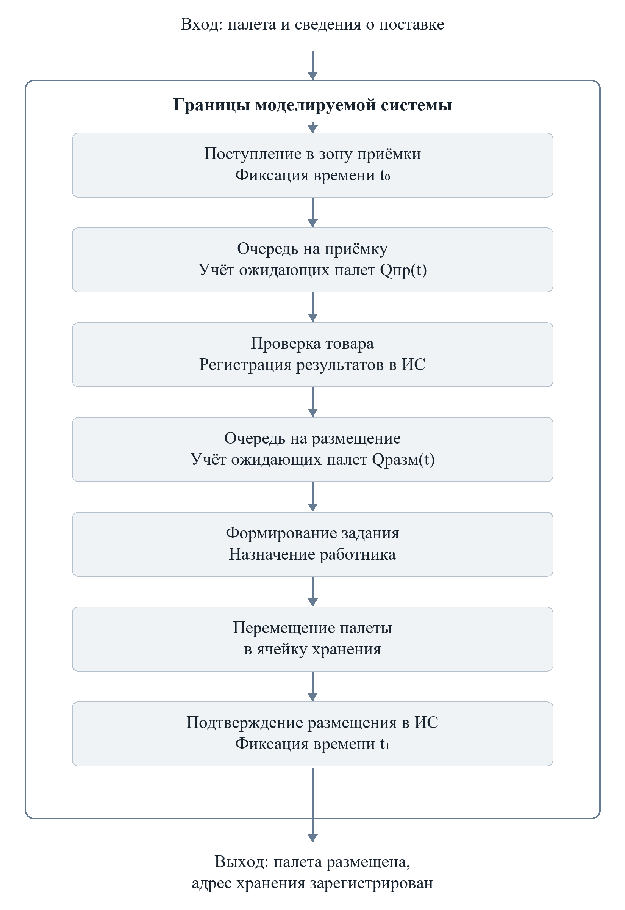
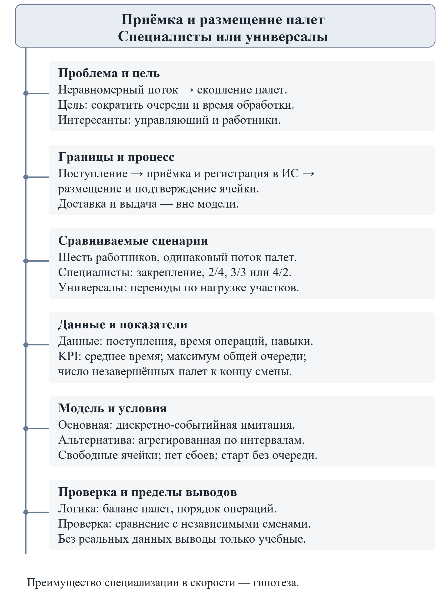

# Моделирование приёмки и размещения палет на складе

Описание модели

## 1 Объект и проблема

При неравномерном поступлении палет нагрузка на участки приёмки и размещения изменяется. Недостаток работников вызывает накопление товара перед соответствующим участком. Скопления занимают рабочее пространство и увеличивают время обработки. Цель — сократить очереди и время обработки имеющимися ресурсами.

## 2 Заинтересованные стороны

Управляющий заинтересован в выполнении объёма работ, сотрудники — в равномерной загрузке и сокращении перегрузок и простоев.

## 3 Решение

Сравниваются шесть специалистов с постоянным закреплением за участками (2/4, 3/3, 4/2) и шесть универсалов с перераспределением. Универсал переходит после завершения операции, если очередь другого участка превышает очередь текущего более чем на k палет; на исходном участке остаётся минимум один работник. Решения о переводах выполняются последовательно.

## 4 Вопрос

Как специализация и перераспределение универсалов при различной интенсивности поступлений влияют на время обработки, максимальную очередь и остаток незавершённой работы?

## 5 Границы

От поступления палеты в зону приёмки до подтверждения ячейки хранения в ИС. Внутри: очереди, операции, работники и регистрация данных. Внешние условия: поступления, характеристики товара и график смены. Доставка, разгрузка и выдача исключены.

## 6 Схема

Поступление, очередь на приёмку, проверка и регистрация, очередь на размещение, задание, перемещение, подтверждение ячейки. Граница и точки измерения показаны в приложении А.

## 7 Словарь величин

| Величина и единица | Роль | Источник |
| --- | --- | --- |
| aᵢ — поступление, мин | Вход | Журнал поступлений |
| sᵢпр, sᵢразм — длительности, мин | Вход | Наблюдения, ИС; по квалификации |
| Qпр(t), Qразм(t) — очередь, палет | Состояние | События модели |
| cпр(t), cразм(t) — работники, чел. | Управление | Сценарий; сумма равна 6 |
| k — порог перевода, палет | Управление | Сценарий; k > 0 |
| Квалификация — категория, без единицы | Параметр | Сведения об обучении |
| Tᵢ — полное время, мин | Выход | Метки поступления и завершения |

## 8 Показатели результата

Все KPI минимизируются. T̄ = Σ(t₁,ᵢ − aᵢ)/N — среднее полное время для всех N палет смены; t₁,ᵢ — подтверждение размещения. Qmax = max₀≤t≤H[Qпр(t) + Qразм(t)] — максимальная суммарная очередь. Nнезав = Nпост(H) − Nразм(H) — остаток к концу смены H, включая палеты в обработке. Среднее скрывает отдельные длительные задержки, поэтому оценивается совместно с очередью и остатком.

## Правило окончания эксперимента

В момент H фиксируется остаток и прекращаются поступления. Для расчёта T̄ все палеты доводятся до завершения при прежнем числе работников и правиле распределения; продолжение не входит в Qmax за смену. Оно является техническим условием расчёта, а не рекомендацией сверхурочной работы.

## 9 Допущения

Палета неделима; иначе изменятся операции и единицы учёта. Старт без очередей; начальный остаток увеличит нагрузку. Ячейки доступны, техника и ИС исправны; нехватка мест и сбои увеличат задержки. Длительные расхождения с поставщиком исключены; их наличие увеличит время обработки. Переводы считаются мгновенными; существенное время перехода снизит пользу перераспределения. Очереди обслуживаются по поступлению; приоритеты изменят ожидание отдельных палет.

## 10 Варианты модели

Агрегированная динамическая модель оценивает накопление по интервалам: нужны поступления и производительность, но сглаживаются отдельные события. Дискретно-событийная модель отслеживает палеты и занятость работников: нужны времена событий и длительности операций, маршруты учитываются упрощённо. Выбрана вторая модель, позволяющая непосредственно вычислить KPI. Сначала скорости операций одинаковы, затем варьируется предполагаемое преимущество специалистов. Во всех сценариях поток и график одинаковы. Развитие — автоматизация регистрации сканированием кодов.

## 11 Проверка

Логика: 10 палет без новых поступлений должны завершить обе операции; проверяются баланс палет, неотрицательные очереди и отсутствие двойной занятости. Согласие: KPI и динамика очередей сравниваются с независимыми сменами, не использованными при настройке. При случайных длительностях нужны повторные прогоны. Допустимые отклонения задаются до сравнения; без наблюдений проверяется только логика.

## 12 Ограничения

Условные данные дают учебные выводы. Не оцениваются выдача, безопасность проходов, физическая нагрузка и окупаемость. Планировка отражена временем размещения. Выводы действуют для исследованных условий; реальные журналы пока отсутствуют.

## Приложение А Схема процесса

Рисунок А.1 — Границы процесса и точки измерения.

## Приложение Б Ментальная карта

Рисунок Б.1 — Постановка задачи моделирования.
